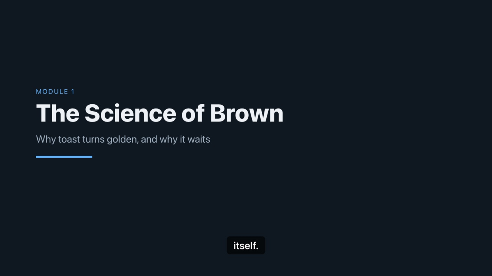
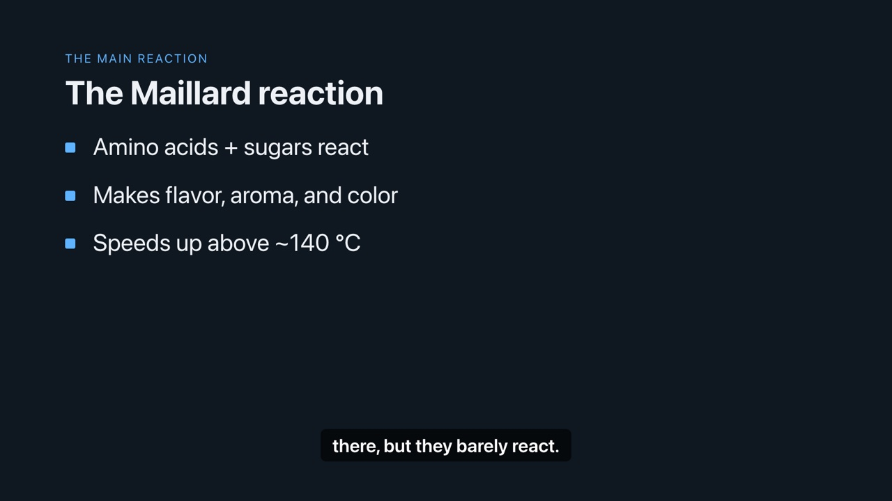
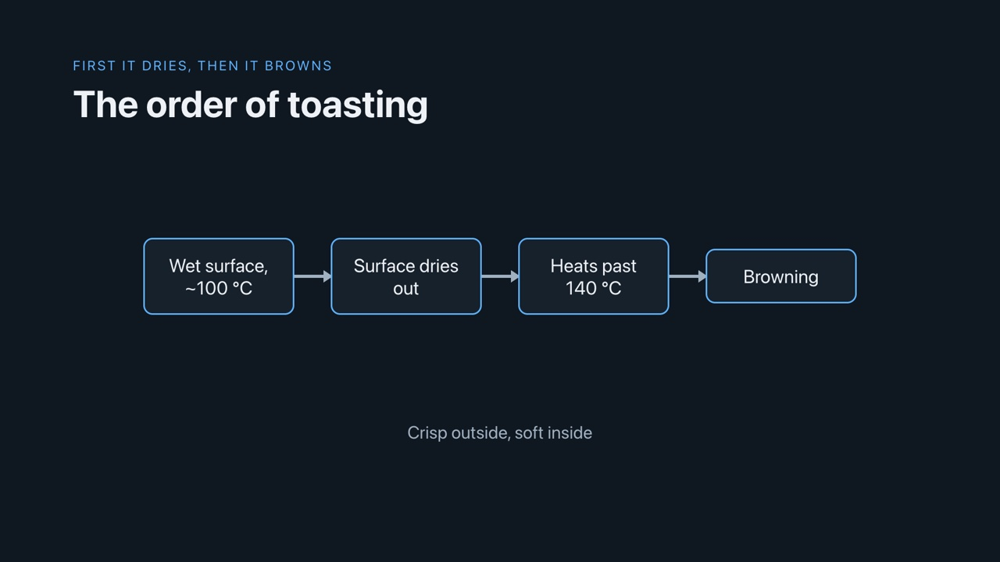
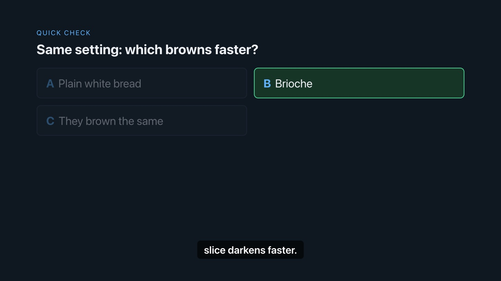

<div align="center">

# 🎓 syllabus-to-course

### Can't take the class? Learn it anyway.

A [Claude Code](https://claude.com/claude-code) skill that turns any syllabus (PDF, Word, pasted text, or web page)
into a complete **self-study course**: lessons, exercises with solutions, quizzes, resources,
and optional **narrated video lectures** rendered on your machine.

[](LICENSE)
[](https://claude.com/claude-code)
[](#-what-it-does)
[](#-what-it-does)
[](https://github.com/SeloTapeTM/syllabus-to-course)

**[Install](#-install)** · **[Use](#-use)** · **[See it work](#-see-it-work)** · **[Video lectures](#-video-lectures-optional)**

</div>

---

## 🧠 What it does

You give Claude a syllabus. You get the course back, built around **your** level, weekly hours, and goal.

- 📚 **Follows the syllabus faithfully**: every topic, in order, nothing invented
- ✍️ **One module at a time**: objectives → lesson → practice (with solutions) → quiz → resources
- ✅ **Built-in accuracy checklist** before each module ships
- 🎬 **Optional video lecture per module**: slides, natural voice, word-timed captions, MP4
- 🌍 **Any subject, any language**: reads Hebrew and Arabic syllabi correctly (RTL-aware extraction)

## 🚀 Install

```bash
git clone https://github.com/SeloTapeTM/syllabus-to-course ~/.claude/skills/syllabus-to-course
```

Restart Claude Code. To update later:

```bash
git -C ~/.claude/skills/syllabus-to-course pull
```

## 🪄 Use

In Claude Code:

```
/syllabus-to-course path/to/syllabus.pdf
```

Or just share a syllabus and say *"make me a course from this"*.

Claude works in four phases and checks in with you between each:

| Phase | What happens |
|---|---|
| 1️⃣ **Intake** | Reads the whole syllabus, lists what's missing, asks your level, hours/week, and goal |
| 2️⃣ **Course map** | Proposes the full module outline for your approval |
| 3️⃣ **Modules** | Writes them one at a time: lesson, practice, quiz, resources |
| 4️⃣ **Wrap-up** | Optional final quiz, capstone project, or next steps |

## 👀 See it work

🍞 **[TOAST 101: Foundations of Applied Toast Studies](examples/toast-101/)**: a completely made-up syllabus, run through the skill.

| Step | File |
|---|---|
| 📄 The input syllabus | [`syllabus.md`](examples/toast-101/syllabus.md) |
| 🗺️ Phase 2 course map | [`course-map.md`](examples/toast-101/course-map.md) |
| 📘 A full module | [`Module-01-Science-of-Brown.md`](examples/toast-101/Module-01-Science-of-Brown.md) |
| 🎬 Its video manifest | [`course_manifest.json`](examples/toast-101/module-01/course_manifest.json) |
| ▶️ The rendered video | [`module.mp4`](examples/toast-101/module-01/module.mp4?raw=true) (1:45, 5 MB) |

**▶️ Module 1 video lecture** (1:45, narrated, word-timed captions):

https://github.com/user-attachments/assets/c2b4862c-3d43-4060-a837-ea9d50e88b0b

**Slide templates in action** (5 scenes):

<p>
  
  
</p>
<p>
  
  
</p>

## 🎬 Video lectures (optional)

After a module is done, ask for *"the video lecture for module 3"*. Everything renders locally, with no cloud APIs.

Slide templates: `title-slide` · `bullet-slide` · `diagram` · `code` · `quiz-question` · `summary`

<details>
<summary><b>Requirements and setup</b></summary>

<br>

- Node 22+, ffmpeg
- HyperFrames CLI + headless Chrome
- Kokoro TTS (Python 3.10+)
- whisper.cpp for captions (optional, skip with `--no-captions`)

Check what's missing:

```bash
node ~/.claude/skills/syllabus-to-course/video/build_video.mjs --doctor
```

Claude asks before installing anything. Full details: [references/video-lecture.md](references/video-lecture.md).

</details>

## 🧰 What's inside

```
SKILL.md                  # the skill instructions Claude follows
templates/                # course map, module, and wrap-up templates
references/               # accuracy checklist, video pipeline guide
video/                    # local video renderer (slides + TTS + captions)
examples/toast-101/       # demo course (fictional syllabus)
assets/                   # README images
```

## 📄 License

MIT, see [LICENSE](LICENSE).

<sup>Includes GSAP (© GreenSock/Webflow) in `video/vendor/gsap.min.js`, used under the [GSAP Standard License](https://gsap.com/standard-license). The MIT license covers everything else in this repo.</sup>
